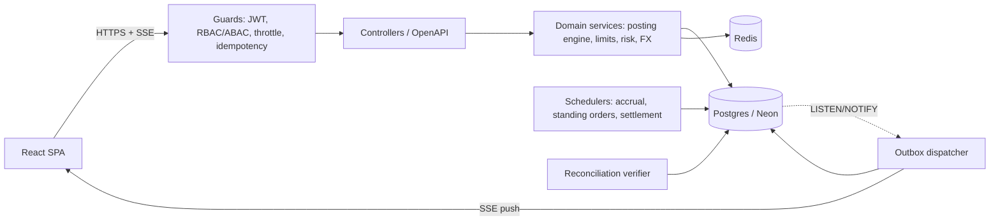
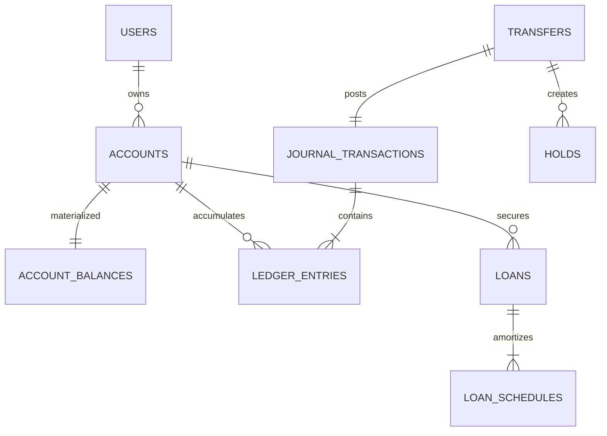
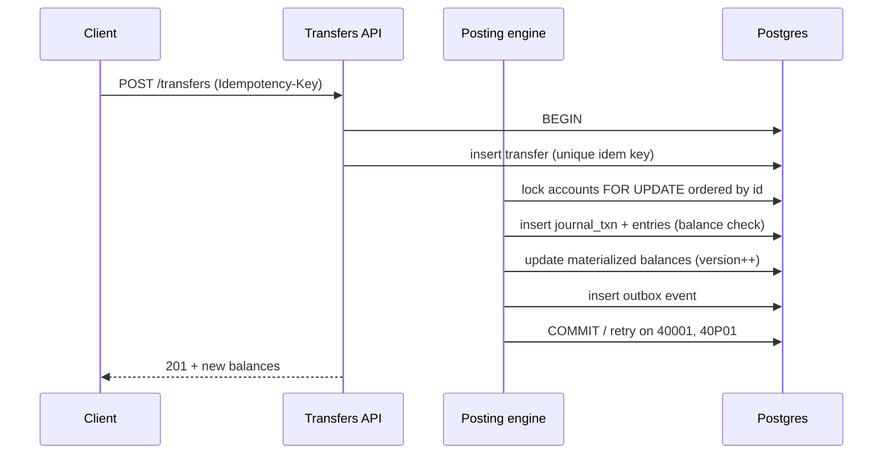
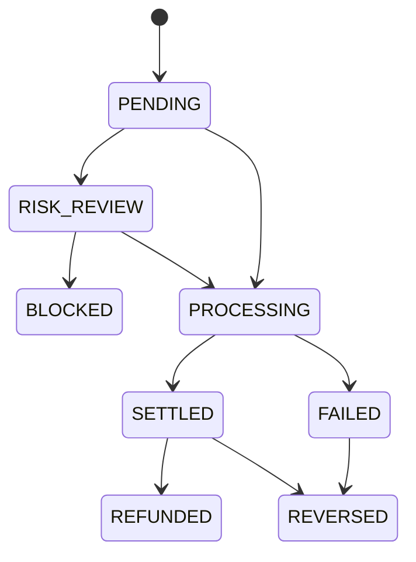
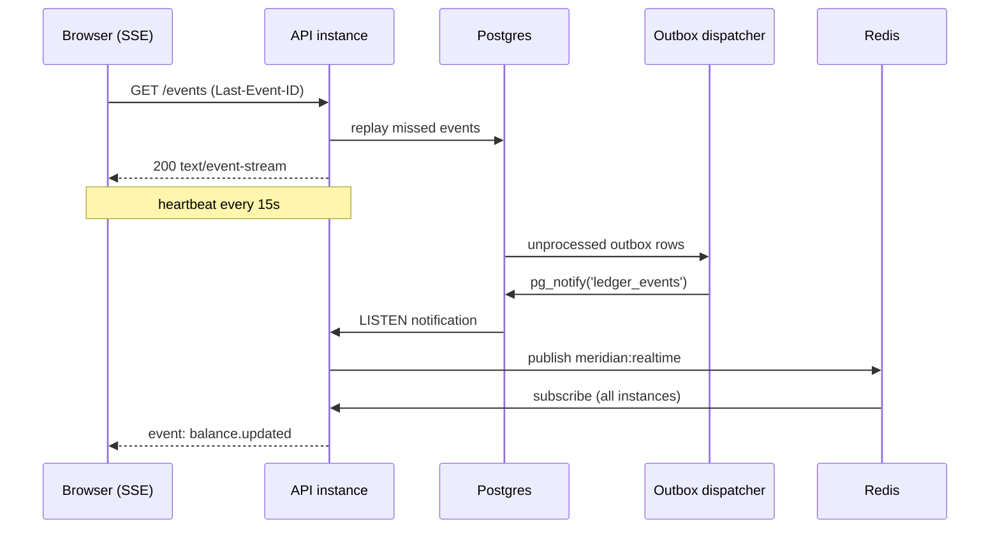

# Meridian — core-banking demo (NestJS + React + Postgres)

Portfolio-grade banking system. Two goals at once:
1. **Basic banking** that a non-engineer can use (sign up, move money, see history).
2. **Deep financial engineering** that a reviewer can audit (double-entry ledger, concurrency
   correctness, idempotency, interest accrual, risk engine, reconciliation).

Working name: **Meridian**. Rename freely.

---

## 1. Stack decisions

| Concern | Choice | Why |
|---|---|---|
| API | NestJS 11, TypeScript strict | Guards/interceptors/DI map cleanly onto auth, idempotency, audit |
| DB | Postgres (Neon) | Real transaction semantics, deferred constraints, `NUMERIC`, LISTEN/NOTIFY |
| DB access | Prisma for CRUD + **raw SQL for the ledger hot path** | Prisma for velocity, hand-written SQL where isolation/locking matters |
| Cache/counters | Redis (Docker locally) | Token-bucket rate limits, velocity counters, hot reads |
| Queue/events | Transactional **outbox** table + worker (+ LISTEN/NOTIFY) | No lost events, no extra infra needed |
| Money | `BigInt` minor units + currency scale table | Never floats. Banker's rounding at 4dp for rates |
| Home currency | **NGN (naira), kobo minor unit, banking day in Africa/Lagos** | One currency is the product default; the other 9 exist to prove multi-currency is real |
| Real time | Postgres `LISTEN/NOTIFY` -> outbox -> Redis pub/sub -> **SSE** with `Last-Event-ID` replay | Balances and transfer state appear without polling; reconnect is lossless |
| Auth | argon2id + JWT access (15m) + rotating refresh with reuse detection | Shows real session security, not tutorial JWT |
| Web | React 19 + Vite + TS, TanStack Query/Router, Zustand, Tailwind + shadcn/ui, Recharts | Query cache matches server state; charts for cashflow |
| API types | `openapi-typescript` generated client from Nest Swagger | Frontend can never drift from backend |
| Tests | Vitest/Jest, Testcontainers Postgres, fast-check (property), k6, Playwright | Invariants proven, not asserted |
| CI | GitHub Actions: lint, typecheck, unit, integration, e2e | Green badge on the repo |

Monorepo (pnpm workspaces):
```
bankapp/
  apps/api        NestJS
  apps/web        React
  packages/money  money/currency/rounding, shared by api + web
  packages/contracts zod schemas, generated OpenAPI types
  infra/          docker-compose, k6 scripts, seed data
  docs/           ADRs, architecture diagrams
```

---

## 2. Architecture



---

## 3. Domain model (key tables)

Identity: `users`, `credentials`, `refresh_tokens(family_id, used_at)`, `devices`, `roles`,
`permissions`, `user_roles`, `mfa_factors`, `audit_log(hash_prev, hash)`.

Money core (append-only): `journal_transactions`, `ledger_entries`, `accounts`,
`account_balances(version)`, `transfers`, `holds`, `beneficiaries`.

Products: `cards`, `loans`, `loan_schedules`, `interest_rates`, `interest_accruals`,
`fx_rates`, `fx_quotes`, `fees`, `fee_rules`, `limits`, `limit_usage`.

Ops: `risk_rules`, `risk_events`, `review_queue`, `outbox_events`, `notifications`,
`statement_exports`, `reconciliation_runs`.

Ledger shape:
```
journal_transactions(id, kind, status, idempotency_key UNIQUE, reversed_by,
                     hash_prev, hash, created_at)
ledger_entries(id, journal_txn_id, account_id, direction DR|CR,
               amount_minor NUMERIC(30,0), currency, running_balances_after)
accounts(id, ledger_code, type CHECKING|SAVINGS|LOAN|CREDIT|SUSPENSE,
         normal_balance DEBIT|CREDIT, currency, allow_overdraft, overdraft_limit)
```
`ledger_entries` is **append-only**: `UPDATE`/`DELETE` revoked by a migration. Corrections
happen only through reversing postings. Every journal transaction must satisfy
`sum(debit) = sum(credit)` per currency, enforced by a **deferred constraint trigger**, so an
unbalanced posting is impossible even from raw SQL.



---

## 4. The technical core (what makes this portfolio-worthy)

**A. Posting engine.** One SQL transaction per business operation. `REPEATABLE READ` plus
`SELECT ... FOR UPDATE` on the accounts **ordered by id** (deadlock-free), retry with
exponential backoff on `40001`/`40P01`. `Idempotency-Key` on every mutating endpoint, backed by
a unique index: a replay returns the original response instead of double-posting.



**B. Proven invariants.** fast-check property tests generate random posting sequences and assert
the ledger never goes unbalanced; a k6 test fires 500 concurrent transfers at one account and
asserts the final balance to the cent. A tamper-evident hash chain
(`hash = H(prev_hash ‖ payload)`) plus `pnpm ledger:verify` that reports the first broken link.

**C. Two-phase money.** Card authorizations as `holds` -> capture or void;
`available = balance - holds`. Overdraft, NSF ordering rules, and fee deduction priority.

**D. Interest, loans, amortization.** Daily accrual on average daily balance with day-count
conventions (30/360, ACT/365), period-end posting and capitalization. Annuity loan schedules,
early repayment with interest recompute, and a payoff simulator.

**E. FX.** Base-currency cross rates, spread, quote locked with a TTL, conversion posted as a
4-leg journal (debit source, credit FX position, debit position, credit target).

**F. Reversals and saga.** Refunds, chargebacks and failures post **compensating** entries; a
multi-step cross-currency transfer is a saga where each step has an inverse.

**G. Limits + risk.** Velocity limits (per txn, daily, monthly) using atomic Redis counters with
timezone-aware reset. A small rules DSL (JSON predicates -> evaluator) for fraud rules, plus a
z-score anomaly check against the customer's own spend history. Decision: ALLOW / REVIEW / BLOCK
with a manual review queue and **step-up 2FA** above a threshold.



**H. Real-time.** Every posting writes an outbox row in the same transaction as the money
movement. A dispatcher reads the outbox, emits `pg_notify`, and a bridge republishes onto a Redis
channel so any number of API instances can fan out to their own clients. Clients hold an SSE
stream (`/api/events`) and receive typed events: `balance.updated`, `transaction.posted`,
`transfer.state_changed`, `notification.created`, `fx.rate_updated`, `risk.review_required`.



Guarantees: events carry a monotonic sequence, so a reconnecting client replays exactly the
events it missed and never double-counts. The stream is authenticated per user and filtered
server-side: a customer only ever sees their own accounts. The UI applies the pushed event as a
cache patch (optimistic), then reconciles against the authoritative balance on the next fetch.

**I. Reconciliation + observability.** Nightly job re-derives every balance from entries, diffs
against the materialized values, and writes a discrepancy report (with a suspense account for
unmatched items). OpenTelemetry traces API -> DB -> worker, Prometheus metrics, correlation IDs,
structured logs, health/readiness probes.

**J. Security.** argon2id, refresh rotation with **family reuse detection**, TOTP MFA, RBAC +
ABAC (amount- and product-aware) guards, device/session revocation, append-only hash-chained
audit log, helmet/CORS/CSRF posture, strict DTO validation.

Basic features (all included): register/login, profile, accounts, deposit/withdraw, internal
transfer, history with filters + keyset pagination, beneficiaries, scheduled transfers,
notifications, PDF/CSV statements, admin basics, dark mode, responsive UI.

---

## 5. API surface (representative)

```
POST   /auth/register | /auth/login | /auth/refresh | /auth/logout
POST   /auth/mfa/enroll | /auth/mfa/verify
GET    /me | /me/sessions | DELETE /me/sessions/:id
GET    /accounts | /accounts/:id | /accounts/:id/statement.csv|.pdf
POST   /accounts/:id/deposit | /accounts/:id/withdraw
POST   /transfers              (Idempotency-Key, step-up if over threshold)
POST   /transfers/:id/reverse | /transfers/:id/refund
GET    /transactions           (keyset cursor, filters, full-text search)
POST   /beneficiaries | /scheduled-transfers
POST   /fx/quote | POST /fx/convert
GET    /loans | POST /loans | GET /loans/:id/schedule | POST /loans/:id/payoff-quote
GET    /cards | POST /cards/:id/authorize | capture | void
GET    /admin/review-queue | /admin/risk-rules | /admin/ledger | /admin/reconciliation
GET    /events (SSE live feed)
```

---

## 6. Frontend screens

Dashboard (net worth, cashflow chart, recent activity, live SSE feed) · Accounts list/detail ·
Transfer wizard (recipient -> amount -> risk check -> step-up MFA -> receipt, optimistic submit
reconciled against server) · Transactions (filters, search, keyset infinite scroll, virtualized) ·
Statements · Cards (authorize/capture demo) · Loans (amortization table + payoff slider) ·
Scheduled transfers · Beneficiaries · FX converter · Notifications · Security (2FA, devices) ·
Admin (users, review queue, risk rules editor, **Ledger Explorer**: journal transactions, debit/
credit legs, hash-chain verification badge, reconciliation report).

Quality floor: WCAG AA contrast and keyboard paths, real labels, skeleton/empty/error states,
reduced-motion honoured, `Intl` for dates and money, responsive to 360px.

---

## 7. Roadmap (each phase ends green + demoable)

| # | Phase | Acceptance criteria |
|---|---|---|
| 0 | Scaffold: monorepo, docker-compose (pg + redis + mailhog), env validation, Swagger, CI | `pnpm dev` boots both apps, `/health` ok, CI green |
| 1 | Identity: argon2id, JWT + refresh rotation w/ reuse detection, RBAC, TOTP MFA, audit log | refresh reuse revokes family; integration tests pass |
| 2 | **Ledger core**: money lib, postings, DB balance trigger, append-only, hash chain, idempotency, locking + retry, deposit/withdraw/internal transfer, balance materialization | property test + 500-way concurrency test exact; unbalanced insert rejected by DB |
| 3 | Accounts: lifecycle, holds, overdraft/NSF, fees, statements PDF/CSV, keyset pagination | statement totals reconcile with ledger |
| 4 | Payments: transfer saga + state machine, beneficiaries, standing orders, external payment sim, settlement worker, outbox, reversals/refunds, webhooks | outbox delivers at-least-once; kill worker mid-flight and state recovers |
| 4b | **Real time**: outbox -> `LISTEN/NOTIFY` -> Redis pub/sub -> SSE, per-user fan-out, monotonic event ids with `Last-Event-ID` replay, live balance/state/notification events, web hook fan-out to the SPA | balance change reaches an open browser in under 500 ms; a dropped stream reconnects and replays missed events exactly once |
| 5 | Credit: rates, daily accrual, capitalization, loans, amortization, payoff simulator | accrual math matches hand-computed fixtures to 4dp |
| 6 | FX: rates, TTL quotes, 4-leg conversion, multi-currency accounts | conversion round-trips within spread, no money created |
| 7 | Risk + limits: Redis velocity counters, rules DSL, anomaly scoring, review queue, step-up auth | concurrent limit test cannot exceed limit; rules unit-tested |
| 8 | Observability + perf: OTel, metrics, k6 report, index tuning with EXPLAIN before/after | published p95 + before/after query plans |
| 9 | Frontend: all screens, SSE, admin console, ledger explorer, a11y + Playwright e2e | Lighthouse a11y >= 95, e2e covers money paths |
| 10 | Portfolio polish: README with diagrams, ADRs, seeded demo data, deploy (Neon + Fly/Render + Vercel), demo GIF | public URL with demo login |

Sizing: phases 0-2 are the highest-value core; 3-7 are the technical differentiators; 8-10 are
what makes it look shipped. Total is substantial work, delivered in that order so that stopping
early still leaves a coherent product.

---

## 8. Open decisions (defaults chosen unless you say otherwise)

1. **Auth**: custom JWT + rotation (default) vs Clerk/Auth0. Custom, because the security logic is
   part of the portfolio.
2. **Currency**: **NGN is the home currency** (kobo minor unit, `en-NG` rendering, `Africa/Lagos`
   banking day, limits and seed data in naira). USD, EUR, GBP, ZAR, KES, GHS, CHF, CAD and JPY
   exist as FX accounts to prove multi-currency correctness.
3. **Redis**: required locally via Docker. Falls back to Postgres advisory-lock counters if you
   want zero extra services.
4. **Deploy target**: Neon (DB) + Fly.io or Render (API + worker) + Vercel (web).
5. **Email/SMS**: Mailhog locally, console transport, provider swap behind an interface.

## 9. What I need from you

- `DATABASE_URL` (Neon). Ideally both the **pooled** URL (app runtime) and the **direct** URL
  (migrations). Nothing else is blocked without it: phases 0-2 run against local Docker Postgres.
